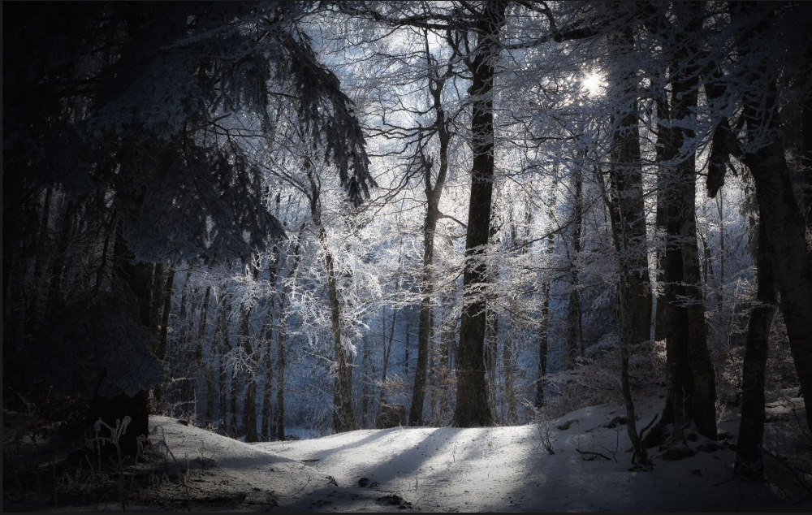
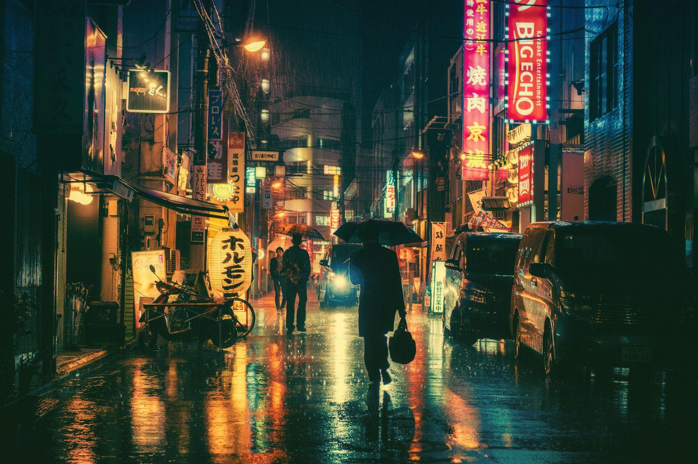
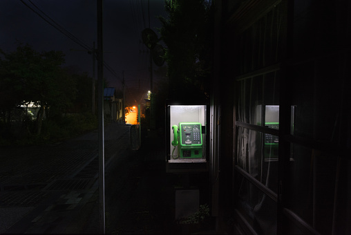

当披头士《挪威的森林》的旋律在机舱内响起，三十七岁的渡边彻感到一阵剧烈的震颤——青春的记忆犹如一片幽暗的冷杉林，将他重新吞没。《挪威的森林》，村上长篇系列我阅读的第一本（之前读过《且听风吟》，故此处说长篇），并非仅仅是一曲哀婉的青春挽歌，更是一场关于死亡、孤独与自我救赎的残酷剥离。书中有句叩击灵魂的谶语：***死并非生的对立面，而作为生的一部分永存。*** 漫步在青春的森林里，我们想要理解那痛彻心灵的成长，也许在遍地死去的记忆中，也许在对生命支点的遍地逡巡中，也许，最不希望地，在曾经的旧梦里。谁又知道呢？毕竟我也在青春的森林里。

执笔，或是打字。本篇书评我想从书中的四个女性角色入手，谈谈我对她们人生选择的理解和看法。一点个人的阅读侧写，无关对错。她们分别是：直子、初美、玲子和绿子（林少华译版）。

<!-- more -->

## 直子 | 困于无菌室的十七岁幽灵
直子的悲剧，早在她与木月青梅竹马的岁月里就已埋下伏笔。在初读时，我们极易将直子视作一个被抑郁症和命运意外摧毁的脆弱少女，但拨开青春伤痛的迷雾，直子真正面临的困境，是她对“绝对纯粹”的病态执念。她与木月构建的并非寻常的恋爱关系，而是一个严丝合缝、没有一丝杂质的“精神无菌室”。在这个封闭的共生系统里，他们互为彼此的感官与灵魂，抵御着外界一切粗糙的干预与成长的阵痛。

然而，这脆弱的稳定不久便在泥沙俱下的混乱中崩塌了。木月的自杀，如同在这个无菌室的玻璃上砸开了一个惨烈的豁口，现实的冷风带着致命的病菌疯狂灌注进来。失去了共生宿主的直子，心理时间被永远冻结在了十七岁。她并非没有尝试过自救，她试图在渡边身上寻找新的情感锚点，试图让渡边成为替代的“补丁”来缝合自己碎裂的世界。但渡边终究属于那个有着轰鸣电车、肮脏酒吧和复杂人性的“外部世界”。直子极度敏锐地察觉到了这种灵魂上的排异反应——书中她那句谶语般的**一个人永远守护另一个人，是不可能的**，似乎便是直子对这种共生关系必然破裂的隐约认知。

阿美寮的岁月，是直子试图重建无菌乌托邦的最后挣扎。那里与世隔绝，人们轻声细语，仿佛只要把时间的钟摆人为地停下，就可以假装黑洞不曾存在。但正如她曾向渡边描述过的那口隐秘在草丛中的深井，直子的内里早已跟随着木月塌陷。渡边试图用世俗的、带着体温的爱去填补它，却连哪怕一丝回音都无法激起。

直子最终走向森林深处，与其说是突发的绝望崩溃，不如说是一个存在底层逻辑缺陷的生命系统，在穷尽了一切修复尝试后，选择了必然的宕机。她用肉身的消亡，残忍而决绝地证明了一个事实：人永远无法依靠攀附他人的物理存在，来填平自己精神世界里的深渊。她拒绝妥协，拒绝带着世俗的污泥与裂痕活下去，最终献祭了自己，化为了那片幽暗冷杉林中，独自伤痛的幽灵。

## 初美 | 坠入虚无冰原的古典幻梦
初美的悲剧，绝非世俗情感语境下的“遇人不淑”，而是一场极具形而上学意味的献祭。在这部充满现代都市迷惘的小说中，初美的存在本身就是一种对“古典崇高感”的招魂——她的死，是古典浪漫主义在现代虚无主义坚壁上的一次惨烈粉碎。

要真正解剖初美，必须先透视她所凝视的深渊——永泽。永泽并非通常意义上的“浪子”，在文学原型上，他更接近于某种极致的“当代英雄”：拥有强悍的世俗手腕、绝对理性的头脑，但精神内核却是一片彻底荒芜的冰原。他是一个绝对冷酷的赌徒，在人生的牌桌上依靠冰冷的逻辑与概率操控一切，试图将道德、共情与软弱从自己人生的运行系统中剔除。在永泽这种极度现代性、绝对利己的异化生存哲学里，他人与世界不过是供他验证自我意志的物理场。永泽的生存逻辑，本质上是一种被异化到极点的“强人虚无主义”。在永泽眼中，世界不过是一台荒诞且没有终极意义的系统，既然一切终归虚无，他便选择将自我意志化作凌驾于情感之上的精密算法。他拒绝共情，将“不同情自己”奉为圭臬，虽然这种信条的确是一条在做决定和判断上有极高效率的标准，但这也反映了一种必须通过强行切除人类固有的软弱与温情来抵御存在主义的深层恐惧。他像一个冷酷的掠夺者，把人生视为一场验证智力与手腕的通关游戏，无论是高阶官僚的头衔还是轻易俘获的肉体，都只是他确证自身强悍的筹码。永泽看似是世俗社会最游刃有余的强者，实则是一个病入膏肓的现代精神空壳。他用绝对的理性为自己打造了一座无坚不摧的堡垒，却也亲手将自己永久地封死在了没有温度的冰原之中。**初美的死，或许是他人生中唯一一次触碰到“真实痛感”的契机，但他终究还是用那套冷酷的法则将其迅速冻结**。多年之后，他站在精神的极寒之地，注定会失去一切深层次的联结，当然这其中也包含主人公渡边。

回到初美，她是这部小说中唯一试图以“意义”去对抗“无意义”的异数。她那身午夜蓝的连衣裙、不合时宜的端庄，本质上是一种拒绝同流合污的精神洁癖。面对永泽灵魂深处的黑洞，初美比任何人都看得真切，但她没有选择明哲保身，而是进行了一场宿命般的豪赌。她企图用最纯粹、最无私的古典之爱，去锚定一个不断向虚无滑落的现代畸形灵魂。初美的爱，不是索取，而是一种带有宗教救赎意味的包容。这种**知其不可奈何而安之若命**的拉扯，正是初美这一角色最迷人、也最令人窒息的艺术张力。

那个渡边、初美与永泽共进晚餐的雨夜，是将这种结构性矛盾推向极致的隐喻。在永泽残酷的逻辑剖析面前，初美的隐忍与落泪，不是弱者的卑微，而是信仰者面对巨大虚无时的最后抵抗。然而，个体的温情终究无法填平存在主义的深渊，纯粹的爱也永远无法解构绝对的虚无。

几年后，已嫁作人妇的初美在德国割腕自杀，这一惨烈的结局补全了这部悲剧的最后一环。初美并非死于迟来的失恋症候群，而是死于自身信仰系统（即对爱与意义的终极确信）的全面崩塌。当现实的坚硬最终绞碎了理想主义的最后一丝余温，初美选择了以肉身的消亡来保全精神的纯粹。当她那抹午夜蓝最终坠入无底的冰原，渡边在多年后的夕阳下，才猛然体会到了那种“无可挽回的震颤”。初美用自己生命的美丽碎裂，完成了一次对现代人精神异化的绝望指控——她不仅是永泽生命中错失的唯一救赎，更是我们在这个荒诞世界中，永远失去的古典幻梦。

## 玲子 | 带着满身裂痕的引路人

玲子与直子不同。直子是一块坠地的冰，碎了便无法拼凑。玲子则是一座坍塌过多次的废墟。

她的悲剧并非源于青春期的存在主义迷惘，而是来自现实世界的具体摧毁。音乐才华的丧失、世俗婚姻的解体、理智的底线被那个恶魔般的初中女生恶意击穿。玲子经历过真正的“坏掉”。但她没有死。她退守到阿美寮，停留在生与死的缓冲地带。在那个掩耳盗铃的乌托邦里，她教人弹琴，种菜，微笑。她将自己打扫干净，成了一个平静的残次品。

玲子是清醒的。她比任何人都清楚，阿美寮的宁静只是一场人造的幻觉。人们在这里人为地拨停时钟，试图用与世隔绝来掩饰内心的巨大空洞。她看着直子在无菌室里日渐枯萎，也看着渡边在外部世界与这里之间艰难拉扯。玲子深知，逃避可以延缓死亡，但无法催生新的生命。她承认自己的病态。而承认，正是自愈的前提。

直子的死，最终打破了玲子苦心维持的平衡。这是一种残酷的驱逐，却也是一次重生的契机。

那场为直子举行的吉他葬礼，是全书最悲怆的送别。连弹五十首曲子，是玲子对过去的彻底清算。随后，她与渡边发生了关系。许多人对此感到错愕，但这绝非庸俗的情欲。在那个被死亡阴影笼罩的夜晚，这是两个冻僵的生者，用最原始的体温确认彼此的存在。这是一场盛大的除魅，是生者对死神的纯粹反击。

玲子最终离开了阿美寮。她穿上直子的旧衣服，坐上了前往旭川的电车。

这个细节极具隐喻。她没有将死者遗弃在回忆里，而是将其穿在身上，重新踏入粗糙的红尘。玲子的存在，提供了一种强悍的幸存者哲学：愈合，并不意味着恢复原状。我们永远无法回到那个未曾受创的自己。生活本就是破败的。不求完好无损，只求带着满身裂痕，继续去吹现实的冷风。

承认残缺，就像玲子常笑着对待自己的皱纹一样，就算是满身伤痕的半老徐娘，也当有重新站起生存的勇气，这也算是整本书中难得的治愈吧。

## 绿子 | 废墟上野蛮生长的春之熊

如果将绿子仅仅解读为驱散阴霾的“红玫瑰”或是单纯的乐天派，无疑是对村上春树文本深度的一种消解。绿子那蓬勃甚至略带侵略性的生命力，并非源于对世界天真无知的无忧无虑，而是恰恰植根于她与死亡的贴身肉搏之中。她的双亲皆因脑癌在痛苦的消磨中离世，她比直子更早、也更频繁地被迫凝视衰老、病痛与死亡的深渊。然而，面对命运的残酷剥夺，绿子拒绝像直子那样退缩进精神的无菌室。她选择用最具烟火气的方式去消化死亡的阴影——在病榻前坦然地面对父亲的排泄物，转头依然能大口吞咽放了许多葱花的煎鸡蛋。她以一种近乎野蛮的粗粝感，宣告了生者的特权。

在绿子的生存哲学里，生命本就是一团凌凌草草的混乱，因此无需去追求那种毫无瑕疵的“纯粹”。如果说直子与木月的世界是一碰即碎的水晶，那绿子就是一个充满血肉质感的、喧闹的有机体。她满不在乎地谈论性爱，毫不掩饰世俗的欲望，甚至向渡边索要一种看似极其霸道且无理的“百分之百的爱”。这种索取，与直子那种试图寻找“终极拯救者”的病态依附截然不同。绿子的“百分之百”，恰恰是生者对存在感最为热烈的确证。她不要虚无，她想要滚烫炽烈的占有，她需要切切实实地被感受、被选择，以此来对抗这个随时会让人灰飞烟灭的荒诞世界。

对于在生死边缘游离的渡边而言，绿子是现实世界抛下的一枚沉重且真实的锚。当渡边即将被幽暗冷杉林里的死亡引力彻底吞噬时，是绿子身上的体温、她做的美味饭菜、以及她那些充满世俗生命力的嗔怪，硬生生地将他从死神的领地里拽了回来。小说结尾，渡边在公共电话亭里给绿子打电话，身处“哪里都不是的地方”呼唤着她的名字，而这也是本书最后的隐喻。在经历了周遭世界的接连坍塌后，渡边终于意识到，没有任何一种纯粹的理想能够抵御死亡的侵蚀，唯有投入那充满了未知、琐碎与痛楚的真实生活。

选择绿子，就是选择接纳生命的残缺与狼藉，是在满目疮痍的废墟上，依然保有去爱一只“春天的熊”的勇气。在渡边遍地死去的记忆中，绿子是唯一鲜活的坐标。

## 尾声 | 风已过，路待行
我常常想渡边的人生，一样对无聊的大学生活祛魅，不一样的时代，不一样的谋生，和不一样的感情经历与人生轨迹。青春是一场有危机感的创作，不知前路如何，一边踌躇徘徊，一边怂恿前行，就如同走进迷雾的森林。

漫步在这片林间，我们注定会与那些永远停滞在昨日的幽灵擦肩，也会遇到带着满身裂痕却依然大口吞咽世俗烟火的旅人。也许每个人在面对不可预知的虚无时，都曾短暂地做过渴望无菌室的直子，或是向往古典幻梦的初美。但路总是要向前走的。风已过，死神的引力终究要让位于生者的红尘。我们需要像玲子那样缝合起内心的废墟，像绿子那样勇敢地去拥抱生命的凌乱。

**毕竟，真正的泅渡，从来不是为了抵达某个无瑕的彼岸，而那些似葬于青春之雪的遗憾，将继续作为余温，随我们在残缺人间起舞。**