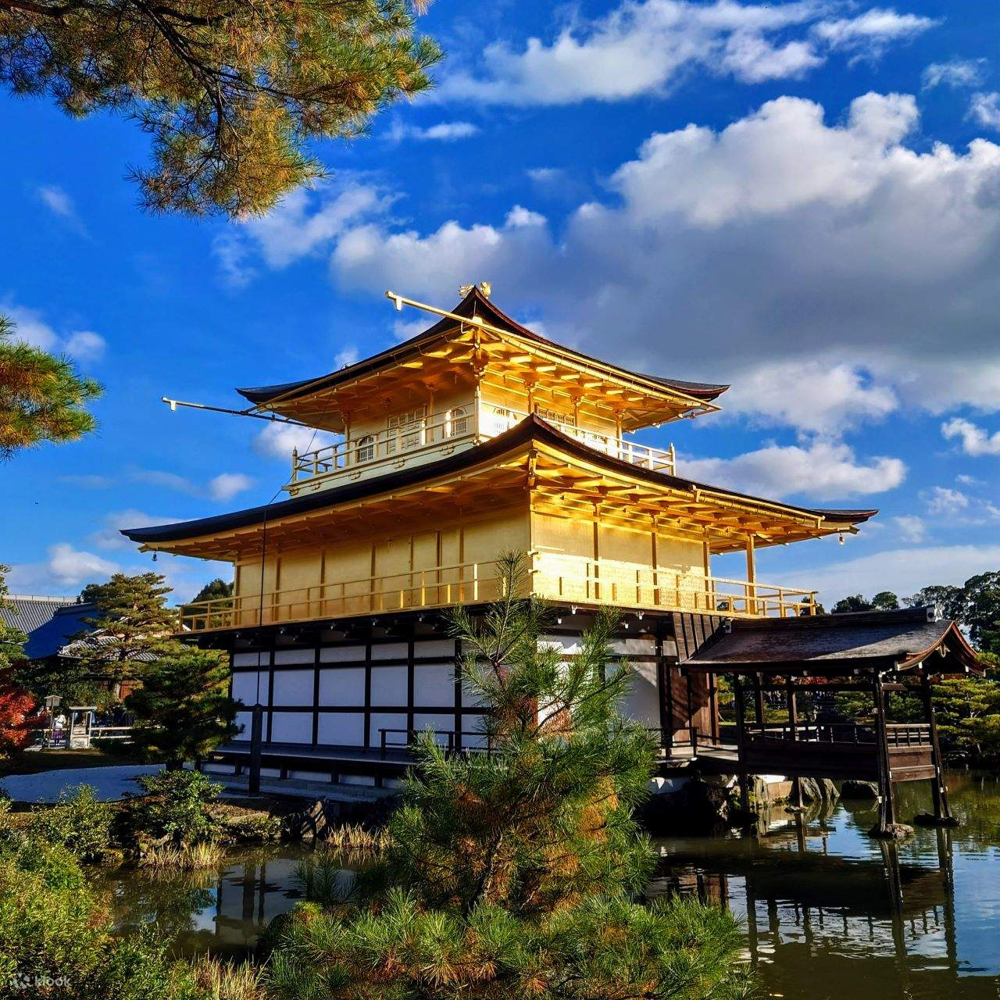
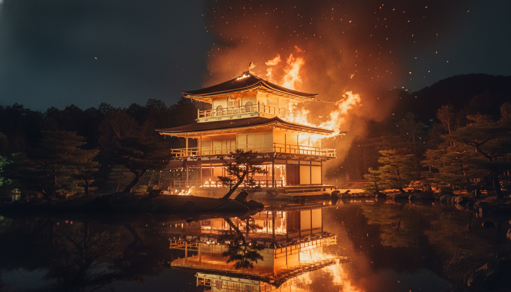

## 缘起
曾经，高三的我坐在教学楼的顶楼的天台沿，不时远望栏杆外的灰天，独自翻着《金阁寺》晦涩的书页。那多是假期的自习日，大脑被卷子压的零碎，故而是想找个放空的契机。但似乎一直读到了与鹤川的结识和进入大学，我依旧难以在文字内接受些许兴致，以及一些功利的想获得作文积累的想法，反而内心更加压抑，理解迟滞，便匆匆放下了三岛的小说。到今天，那本蒙尘的小书早不知去向。

高考后大痛，却不大悟。大一碌碌无为，大二还是无所事事，迷茫空虚仍然缠绕于心。我尝试看书。我用起了电子书的软件，想起了金阁。我不禁想，金阁能有多痛呢，反正我也千疮百孔。这样想来，读起来竟顺畅许多，便一股气的读下去了。

## 读作
想起写些什么时已经读到后半部分了，文字如下：

在沟口的眼里，逝去的比活着的更容易被爱，活人大多兽行于生，逝者或瞬息将逝之物则美的纯粹。

出游，在社会意义上被看做放逐，在沟口的精神意义上却是在建立自我。回到故乡，那阴郁的根源，遥望粗糙而带有怒气的日本海，看见一切恶念实体化的景物，沟口在这里承认自身恶念的合理性。铅色的海像要凝固，黑色的群山压住海面，流动着的是破坏性的欲念，静止着的是永恒的终结。烧毁静止的美，才能解放流动的生命。

南泉斩猫，沟口烧阁。我们暂且不评价行为的准则与道德规范；单从毁灭的独创来讲，再加上对行动大于认识的理解，沟口的哲学是很清晰的。但我仍然认为，烧毁本身的行为，只毁灭实相，却破解不了执相。心中的金阁如何与现实同步，我觉得这是沟口行动前没能觉悟的认知。

前几日在书店翻阅周国平老师的杂文集时，瞥到过一句大概意思像这样的话：他说人之所以为人，不可以抛弃人的动物性，即人应该有肉体和欲望。我们或都想得到灵魂的升华，沟口更是鄙视众多世俗之人内心的贪念、恶念，但真正属于灵魂的纯粹升华，排除一切黑暗思虑的涅槃，我们付出一切后，就真的能得到吗？人生常悲，欲念难止，若一切安于所欲皆为罪恶，那便不再有救赎，人生真的便是一场忍受。我不否认它的可能，但我认为毕竟还有更多的可能，执着必定困囿，若真的证伪了其余的全部，重拾仍然非晚。

这也确实表明了我的想法，从某种角度，更接近柏木。带着犬儒的影子，承认残缺与变形，看破执相故而又能操控人心，虽然不得解脱忍受的桎梏，但至少更接近悲观的真相吧。

正因徒劳，故而行动。沟口最后的认识是行动本身独立于认知，也就不再惧怕意义的空虚。逢着便杀，无拘于心。沟口低估了死亡，小瞧了生心。烟未散尽，他丢掉了安眠药。

书评上说，沟口有极度的自私。他的心走向死亡之门却被拒绝，他因厌恶拒绝因而选择偷生。三岛也道：**“在应该生的地方让其死，在应该死的地方让其生……这才是真正的人间牢笼。”**

## 叹惋
我不时想过，我无疑也是个懦夫，我也不敢走向完全的黑暗，我甚至不敢丢弃全部的过往。我自诩活在新的生命里，真是虚伪。一切生之希望确实在帮我忍受不堪，帮我舔舐灵魂尖上的发凉的血，蚕食我的腐肉。

**优雅慎重是懦弱的呈现，你还不自知。**